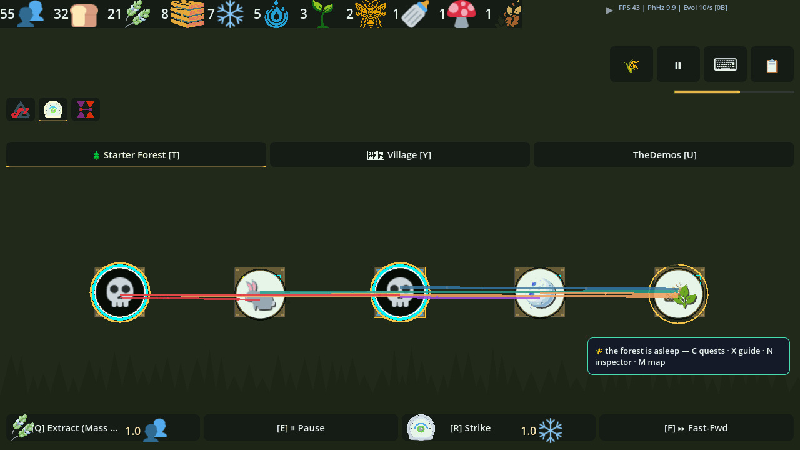
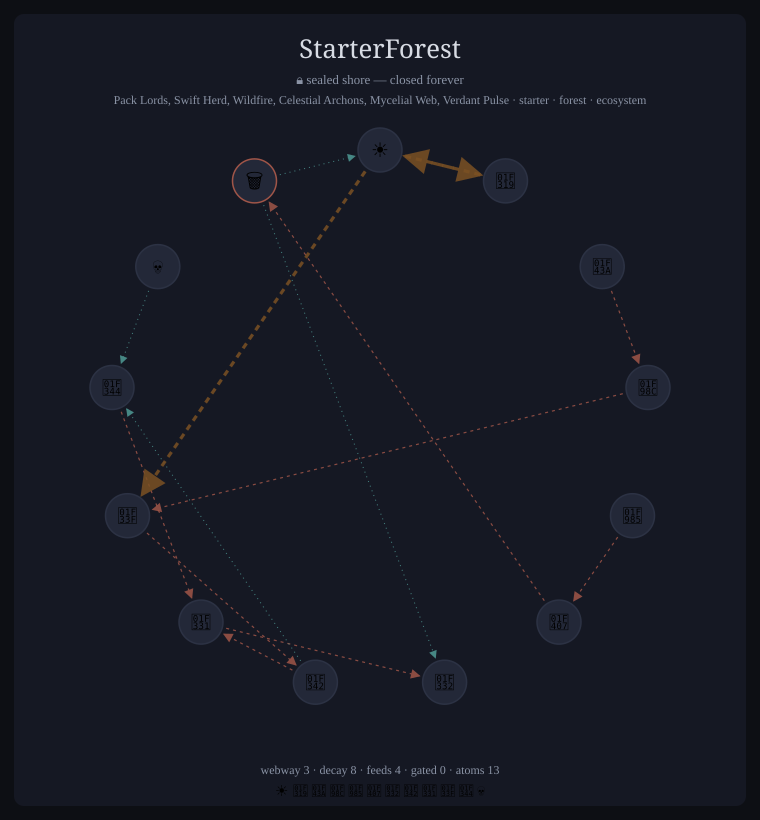
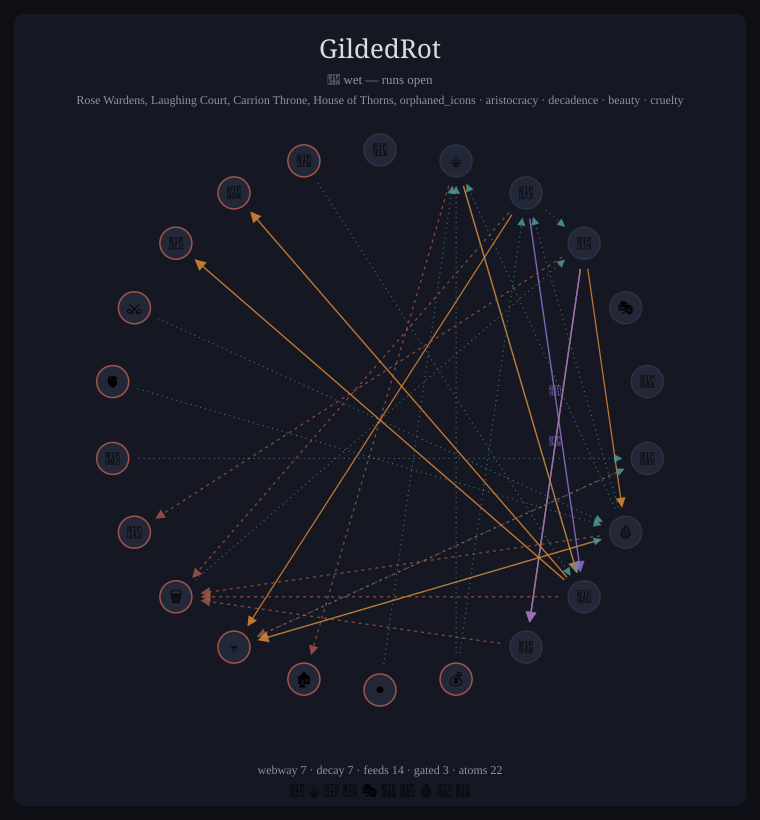
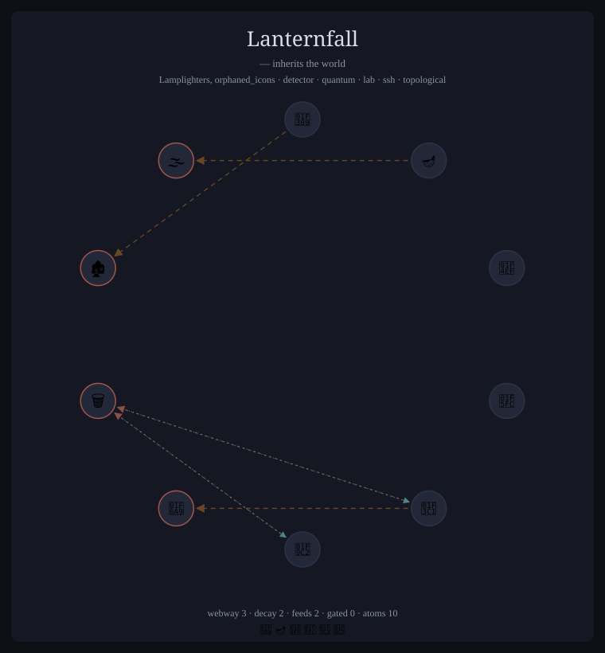

# SpaceWheat

[](https://github.com/AQuantumArchitect/SpaceWheat/actions/workflows/ci.yml)
[](https://github.com/AQuantumArchitect/SpaceWheat/releases)
[](LICENSE)
[](https://godotengine.org)

**A farming game where every field is a real quantum system.** Each plot is a
qubit, each biome is a density matrix evolving under its own Hamiltonian, and
every harvest is a Born-rule measurement. The physics is not a metaphor; it is
the engine, and the story fires when the live quantum state crosses a threshold.

**Built entirely by AI agents I directed; I wrote none of the code.** SpaceWheat
is where I learned agentic development, starting with one chat assistant and
ending with a fleet of coding, playtesting and review bots.
[How it was built →](docs/HOW_THIS_WAS_BUILT.md)



## Play

- **Download (Windows):** the newest build is on the
  [releases page](https://github.com/AQuantumArchitect/SpaceWheat/releases).
  Unzip it and run `SpaceWheat.exe`.
- **From source (Linux or Windows):** open the folder in Godot 4.5 and press
  Play. The native physics library is prebuilt for both in `native/bin/`.

Status: **alpha**. The main campaign, *The Demos* (seven acts), is playable from
the first plot to the ending. Two post-game campaigns, *What Fades* and
*The Loom*, open after it and are still in development.

## The game

You farm a small island. A biome is a cloud of emoji "atoms"; a faction's
**icons** pair two atoms into a qubit (☀️/🌙, 👥/🍞), and every icon you plant
adds a qubit and its terms to the biome's Hamiltonian. The state evolves exactly,
under the unitary `U = exp(−iH·dt)`, so purity stays at 1 until you look.

| Verb | Physics | Game |
|---|---|---|
| **Strike** | projective measurement, Born rule | collapse a qubit to one emoji |
| **Gather** | surprisal, `−kT·log p` | rarer outcomes pay more |
| **Fast-forward** | Hamiltonian evolution | the couplings spin the odds back up |
| **Incorporate** | Berry phase | a qubit that closes a loop teaches you its word |

Factions carry preferences over observables (purity, entropy, coherence), and
the one that resonates most with a biome voices its quests. The campaign is won
by composing a village whose spectral gap stays small: a plural island that
physically cannot collapse into one shape.

The details are in three places, depending on who you are:

- [**Farming a density matrix**](docs/FARMING_A_DENSITY_MATRIX.md): the ten-minute
  essay on what this is and why it refuses to fake its physics.
- [**For physicists**](docs/FOR_PHYSICISTS.md): every concept the game teaches,
  with an honesty grade per claim (exact, faithful or suggestive) and how to
  check it yourself.
- [**How to play**](docs/HOW_TO_PLAY.md) and the [**Game codex**](docs/GAME_CODEX.md):
  controls, the core loop, and the canonical reference for everything else.

## By the numbers

| | |
|---|---|
| Biomes | 164, each with its own Hamiltonian and Lindblad web |
| Factions | 102, with 367 icons (two-emoji qubit axes) |
| Gates | 14 exact unitaries (Paulis, H, S, T, rotations, CNOT, CZ, SWAP); Bell, GHZ and cluster states built from them |
| Simulation | C++ GDExtension on Eigen: exact unitary propagation, Lindblad for open biomes |
| Code | ~126k lines GDScript, ~45k Python tooling, ~6.5k C++ |
| History | 1,250+ commits since December 2025 |

## Repository

```
Core/        game logic: quantum substrate, farm, quests, campaign, factions
UI/          interface
native/      C++ density-matrix engine (GDExtension)
tests/       pytest suite; drives the real game headless where needed
🍄/          the playzone: the rig agents use to play the game from code
tools/       campaign compiler and validator, physics assays, atlas renderer
scripts/     build, export, release
docs/        player and physics docs; design/ and history/ inside
```

Agents start at [AGENTS.md](AGENTS.md). Humans who want to build it start at
[BUILDING.md](BUILDING.md).

```bash
./scripts/launch_game.sh                 # play (Linux)
SW_SKIP_LONG=1 python3 -m pytest tests/  # the test suite
python3 tools/campaign/validate.py       # prove the campaign is completable on paper
```

Known problems are listed in [docs/KNOWN_ISSUES.md](docs/KNOWN_ISSUES.md).

## Gallery

<p align="center">
  
  
  
</p>

Atlas plates are rendered from `biomes.json`, the same file the game boots from
(`python3 tools/atlas_plates.py`). In game, F12 takes a postcard with the
physics (biome, purity, entanglement) written into the pixels and a JSON
certificate beside it.

## License

MIT, see [LICENSE](LICENSE). Bundled assets carry their own terms; Twemoji is
CC-BY 4.0. See [THIRD_PARTY_NOTICES.md](THIRD_PARTY_NOTICES.md).
